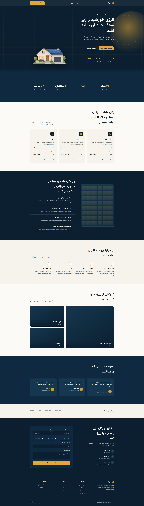

````md
# وب‌سایت انرژی خورشیدی

یک لندینگ پیج مدرن و ریسپانسیو برای یک شرکت فعال در حوزه انرژی خورشیدی و نصب پنل‌های خورشیدی.

## معرفی پروژه

این پروژه با هدف طراحی و پیاده‌سازی یک وب‌سایت حرفه‌ای برای معرفی خدمات یک شرکت انرژی خورشیدی طراحی شده است.

تمرکز اصلی پروژه بر معرفی راهکارهای انرژی خورشیدی، نمایش خدمات، ایجاد اعتماد در کاربر و هدایت بازدیدکننده به سمت دریافت مشاوره و ثبت درخواست بوده است.

طراحی رابط کاربری با استفاده از ترکیب رنگ‌های سرمه‌ای، طلایی و سفید انجام شده تا حس تکنولوژی، انرژی پاک، اعتماد و حرفه‌ای بودن را به کاربر منتقل کند.

## هدف پروژه

هدف اصلی این پروژه ایجاد یک تجربه کاربری ساده و حرفه‌ای برای کاربرانی است که به دنبال استفاده از انرژی خورشیدی برای خانه یا کسب‌وکار خود هستند.

کاربر در طول صفحه ابتدا با خدمات و مزایای انرژی خورشیدی آشنا می‌شود، سپس راهکارها و نمونه پروژه‌ها را مشاهده می‌کند و در نهایت می‌تواند برای دریافت مشاوره اقدام کند.

## بخش‌های اصلی سایت

### ۱. بخش Hero

بخش ابتدایی سایت شامل:

- عنوان اصلی و معرفی انرژی خورشیدی
- توضیحات کوتاه درباره خدمات
- دکمه درخواست مشاوره
- دکمه مشاهده محصولات
- نمایش آمار و اطلاعات کلیدی
- تصویر خانه مجهز به پنل خورشیدی

هدف این بخش انتقال سریع ارزش پیشنهادی شرکت به کاربر است.

### ۲. آمار و اطلاعات

در این بخش چند شاخص مهم برای افزایش اعتماد کاربر نمایش داده می‌شود، مانند:

- سابقه فعالیت
- تعداد پروژه‌های اجرا شده
- میزان بهره‌وری
- پشتیبانی و خدمات

### ۳. معرفی پنل‌های خورشیدی

در این قسمت انواع راهکارها و پنل‌های مناسب برای استفاده‌های مختلف معرفی شده‌اند.

هر کارت شامل اطلاعاتی مانند:

- نوع پنل
- توان
- مشخصات فنی
- کاربرد
- اطلاعات تکمیلی

است.

### ۴. چرا ما؟

این بخش مزیت‌های رقابتی شرکت را به کاربر معرفی می‌کند.

از جمله:

- استفاده از تجهیزات باکیفیت
- نصب تخصصی
- خدمات پس از فروش
- استانداردهای معتبر
- پشتیبانی
- ارائه راهکار متناسب با نیاز مشتری

### ۵. فرآیند نصب

فرآیند دریافت خدمات به صورت مرحله‌ای نمایش داده شده است:

1. دریافت مشاوره
2. بررسی محل
3. طراحی سیستم
4. نصب پنل‌ها
5. بررسی و تست
6. راه‌اندازی سیستم

این ساختار باعث می‌شود کاربر قبل از ثبت درخواست، درک واضحی از روند انجام پروژه داشته باشد.

### ۶. نمونه پروژه‌ها

در این بخش نمونه‌هایی از پروژه‌های اجرا شده نمایش داده می‌شوند تا کاربر با تجربه و توانایی شرکت در اجرای پروژه‌های مختلف آشنا شود.

### ۷. نظرات مشتریان

بخش Testimonials برای نمایش تجربه مشتریان قبلی و افزایش اعتماد کاربران طراحی شده است.

### ۸. فرم درخواست مشاوره

در انتهای صفحه یک فرم برای دریافت مشاوره قرار گرفته است.

کاربر می‌تواند اطلاعات موردنیاز پروژه خود را وارد کرده و برای دریافت مشاوره با شرکت ارتباط برقرار کند.

### ۹. Footer

Footer شامل بخش‌هایی مانند:

- معرفی شرکت
- خدمات
- لینک‌های دسترسی سریع
- اطلاعات تماس
- شبکه‌های اجتماعی
- اطلاعات و استانداردها

است.

## طراحی UI/UX

در طراحی رابط کاربری تلاش شده است یک ظاهر مدرن و حرفه‌ای متناسب با حوزه انرژی و تکنولوژی ایجاد شود.

ویژگی‌های طراحی:

- طراحی مینیمال
- رابط کاربری فارسی و RTL
- سلسله‌مراتب بصری مشخص
- استفاده مناسب از فضای خالی
- کارت‌های مدرن
- گوشه‌های Rounded
- Gradient و Glowهای ظریف
- CTAهای واضح
- طراحی مبتنی بر اعتماد
- تمرکز روی Conversion

## رنگ‌بندی

رنگ‌های اصلی رابط کاربری:

- سرمه‌ای تیره برای ایجاد حس اعتماد و تکنولوژی
- طلایی برای نمایش انرژی خورشیدی
- سفید و کرم برای ایجاد تعادل و خوانایی

## تجربه کاربری

ساختار صفحه بر اساس مسیر زیر طراحی شده است:

```text
آشنایی با برند
      ↓
شناخت انرژی خورشیدی
      ↓
بررسی راهکارها
      ↓
اعتمادسازی
      ↓
مشاهده نمونه پروژه‌ها
      ↓
مطالعه نظرات مشتریان
      ↓
درخواست مشاوره
````

هدف این مسیر تبدیل بازدیدکننده به یک مشتری بالقوه است.




## تکنولوژی‌های استفاده شده

* HTML5
* CSS3
* JavaScript
* Flexbox
* CSS Grid
* Responsive Web Design
* RTL

## ویژگی‌های پروژه

* طراحی کاملاً ریسپانسیو
* پشتیبانی از زبان فارسی
* پشتیبانی از RTL
* ساختار HTML معنایی
* طراحی مدرن و مینیمال
* بخش‌های مختلف مبتنی بر کارت
* فرم درخواست مشاوره
* نمایش نمونه پروژه‌ها
* بخش نظرات مشتریان
* طراحی مناسب برای موبایل و دسکتاپ

## ساختار پروژه

```text
solar-landing/
│
├── index.html
│
├── css/
│   └── style.css
│
├── js/
│   └── script.js
│
├── assets/
│   ├── images/
│   ├── icons/
│   └── logo/
│
└── README.md
```

## وضعیت پروژه

این پروژه به عنوان یک پروژه طراحی و توسعه Front-End پیاده‌سازی شده و شامل طراحی رابط کاربری و توسعه لندینگ پیج ریسپانسیو است.

## طراح و توسعه‌دهنده

**Aria**

طراحی UI/UX و توسعه Front-End

```

### توضیح کوتاه برای بخش Description گیت‌هاب

اگر منظورت قسمت **Description** خود Repository است، این را بگذار:

> **لندینگ پیج مدرن و ریسپانسیو برای شرکت انرژی خورشیدی با طراحی فارسی و RTL، معرفی خدمات، نمونه پروژه‌ها و فرم درخواست مشاوره.**

این نسخه برای پورتفولیو هم مناسب‌تر است، چون علاوه بر معرفی ظاهر سایت، **هدف پروژه و تصمیم‌های UI/UX** را هم نشان می‌دهد.
```
